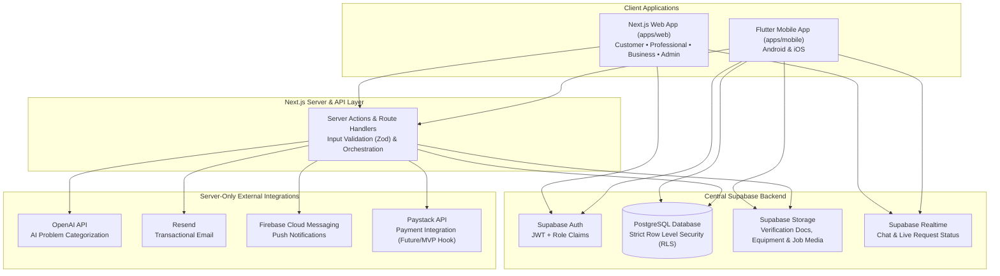

# EasyLife — System Architecture

## 1. Architectural Overview

EasyLife uses a **centralized backend architecture** powered by **Supabase (PostgreSQL, Auth, Storage, Realtime)** serving both the **Next.js Web Platform (`apps/web`)** and the **Flutter Mobile Application (`apps/mobile`)**.

---

## 2. Four Connected User Experiences

All four experiences share a single identity and database model while enforcing strict role boundaries:

1. **Customer Experience (`customer`)**
   - Browse service categories and verified professionals in **Port Harcourt**, **Lagos**, and **Abuja**.
   - Describe everyday problems in natural language for AI-assisted category & urgency classification.
   - Submit service requests, compare quotations, book appointments, message professionals, confirm completion, leave verified reviews, or raise disputes.
2. **Service Professional Experience (`professional`)**
   - Complete professional onboarding and upload verification credentials to private Supabase Storage buckets.
   - Manage service categories, coverage areas, availability, and portfolio.
   - Respond to service requests with itemized quotations, manage scheduled appointments, and record job completion.
3. **Business & Property Maintenance Portal (`business` / `property_manager`)**
   - Manage multiple properties/locations, units, and facility assets.
   - Maintain equipment records (serial numbers, warranty dates, install dates, specifications).
   - Configure preventive maintenance schedules and track complete maintenance history per asset.
4. **Administrator Dashboard (`admin`)**
   - Review and approve/reject professional verification submissions with audit trails.
   - Manage service categories, monitor requests/bookings, arbitrate disputes, and oversee platform accounts.

---

## 3. Monorepo & Package Boundaries

- **`apps/web`**: Next.js (App Router) with TypeScript and Tailwind CSS. Hosts the responsive marketing site, authentication flows, all four role portals, and server-side API endpoints for third-party integrations.
- **`apps/mobile`**: Standalone Flutter project targeting Android and iOS. Uses `supabase_flutter` and communicates with the same central Supabase database, storage buckets, and server API endpoints. Kept separate from npm workspaces to avoid Dart/Node toolchain friction.
- **`packages/shared-types`**: Pure TypeScript package exporting domain types, role enums, status enums, and Nigerian market constants consumed by `apps/web`.
- **`packages/shared-config`**: Shared design system tokens (Deep Navy, Teal, White, Light Grey) and base TypeScript configuration.
- **`supabase/`**: Single source of truth for SQL migrations, Row Level Security (RLS) policies, storage bucket policies, and development seed scripts.

---

## 4. Security & Data Integrity Principles

1. **Row Level Security (RLS) by Default:** Every table in `public` has RLS enabled in the same migration that creates it. No table is left publicly readable or writable without an explicit policy.
2. **Secret Isolation:**
   - `SUPABASE_SERVICE_ROLE_KEY`, `OPENAI_API_KEY`, `RESEND_API_KEY`, `PAYSTACK_SECRET_KEY`, and `FIREBASE_SERVICE_ACCOUNT_JSON` are strictly server-only.
   - No secret variable is ever prefixed with `NEXT_PUBLIC_` or bundled into the Flutter binary.
3. **Input Validation:** Every mutation validates payloads with strict schema validation before touching the database.
4. **Zero Fabricated State:** UI components only display success states after receiving a confirmed response from Supabase or the server action.
5. **Authentic Trust Signals:** Professional verification badges and customer reviews can only be created through verified backend workflows (admin approval for badges; completed jobs for reviews).

---

## 5. Design System Direction

- **Primary Brand Color (Deep Navy):** `#0A192F` (Surface/Header) & `#0F172A` (Text/Primary UI)
- **Accent / Action Color (Teal):** `#0D9488` (Primary CTA, active states, verified badges) & `#14B8A6` (Hover/Highlights)
- **Backgrounds:** Pure White (`#FFFFFF`) for cards/surfaces and Light Grey (`#F8FAFC` / `#F1F5F9`) for app canvas and subtle borders (`#E2E8F0`).
- **Typography:** Clean geometric sans-serif (`Inter` / system UI stack) with high-contrast hierarchy for readability on both desktop and low-bandwidth mobile screens in Nigeria.
