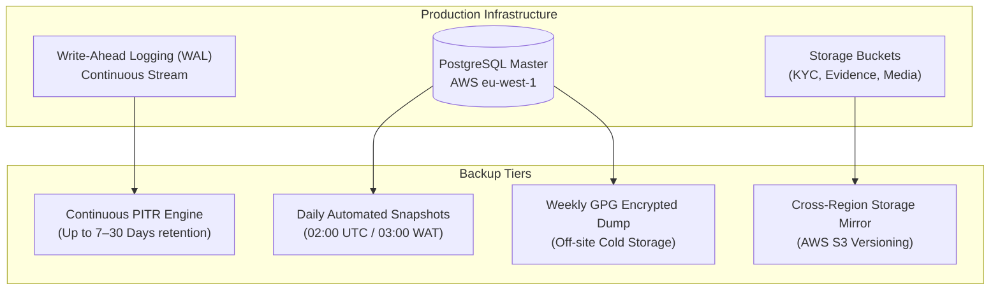
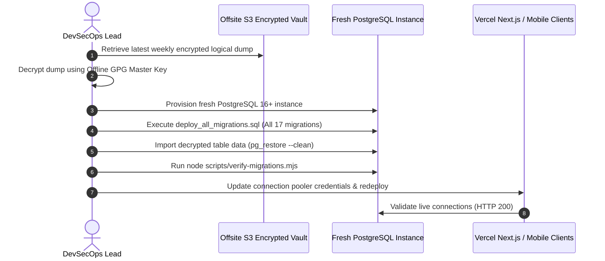

# EasyLife Backup, Disaster Recovery & Business Continuity Plan

**Document ID:** BCP-REC-2026-001  
**Classification:** Confidential — Operations & Infrastructure  
**Target Architecture:** Supabase Enterprise PostgreSQL, AWS S3 Storage, Vercel Edge  
**Version:** 1.0.0  
**Effective Date:** 8 November 2026  

---

## 1. Executive Summary

Data integrity and operational reliability are paramount for EasyLife as a trusted digital marketplace holding financial escrow records, technician credentials, and facility maintenance data. This document outlines the backup schedules, retention policies, disaster recovery runbooks, and failover architectures required to guarantee business continuity.

### Service Level Objectives (SLOs)
- **Recovery Point Objective (RPO):** $\le 1\text{ hour}$ for catastrophic database loss; $\le 5\text{ minutes}$ for standard transactional recovery via Point-In-Time Recovery (PITR).
- **Recovery Time Objective (RTO):** $\le 2\text{ hours}$ to restore full production traffic following an infrastructure-wide outage; $\le 15\text{ minutes}$ for targeted table-level rollbacks.
- **Data Durability:** $99.999999999\%$ (11 9s) for stored media and KYC documents hosted on AWS S3 / Supabase Storage.

---

## 2. Backup Architecture & Schedules



### 2.1 Backup Tiers & Retention Schedules

| Tier | Backup Type | Frequency | Retention Period | Storage Location |
|---|---|---|---|---|
| **Tier 1 (Continuous)** | Write-Ahead Log (WAL) Streaming (PITR) | Continuous real-time stream | 7 days (Pilot) / 30 days (Prod) | Supabase Managed Cloud Storage |
| **Tier 2 (Daily)** | Full Physical Database Snapshot | Daily at 02:00 WAT (01:00 UTC) | 30 days rolling | Managed Multi-AZ Backup Storage |
| **Tier 3 (Weekly Offsite)** | Logical Dump (`pg_dump` compressed & encrypted) | Every Sunday at 03:00 WAT | 365 days (Statutory tax compliance) | Isolated, Air-gapped AWS S3 Bucket (GPG Encrypted) |
| **Tier 4 (Object Storage)** | S3 Bucket Versioning & Lifecycle Rule | On every object modification | 90 days soft-delete retention | AWS S3 Bucket Replication |

---

## 3. Disaster Recovery Procedures & Runbooks

### Runbook A: Point-In-Time Recovery (Accidental Data Corruption or Malicious Modification)

**Scenario:** A faulty script or administrative error accidentally overwrites booking milestones or drops rows.

1. **Identify the Exact Target Timestamp:**
   Query the `public.audit_logs` table to determine the timestamp $T_{\text{target}}$ immediately prior to the corrupting event:
   ```sql
   SELECT created_at, actor_user_id, action, entity_type 
   FROM public.audit_logs 
   WHERE action = 'suspicious_or_corrupting_action' 
   ORDER BY created_at DESC LIMIT 5;
   ```
2. **Initiate PITR in Supabase Management Console:**
   - Navigate to **Project Settings > Database > Backups > Point in Time**.
   - Select the target timestamp: $T_{\text{target}} - 60\text{ seconds}$.
   - Choose to restore to a **New Project / Fork** to prevent overwriting in-flight transactions while verifying data.
3. **Validate Restored State:**
   Run integrity checks against the restored database:
   ```bash
   node scripts/verify-migrations.mjs
   ```
4. **Traffic Rerouting:**
   Update `NEXT_PUBLIC_SUPABASE_URL` and `SUPABASE_SERVICE_ROLE_KEY` in production environment variables to point to the restored instance.

---

### Runbook B: Complete Catastrophic Infrastructure Restoration

**Scenario:** Complete loss of primary Supabase instance or host cloud region outage.



**Restoration CLI Commands:**
```powershell
# 1. Decrypt offsite backup
gpg --decrypt --output easylife_prod_restore.sql.gz easylife_prod_backup.sql.gz.gpg

# 2. Decompress
gzip -d easylife_prod_restore.sql.gz

# 3. Restore schema & data into target PostgreSQL instance
$env:PGPASSWORD = "YOUR_RESTORE_DB_PASSWORD"
pg_restore -h target-db.supabase.co -U postgres -d postgres -v -F c easylife_prod_restore.sql

# 4. Verify structural integrity
node scripts/verify-migrations.mjs
```

---

### Runbook C: Storage Bucket File Restoration

**Scenario:** Accidental deletion of technician KYC credentials or booking attachments.

1. **S3 Object Versioning Recovery:**
   All EasyLife storage buckets must have **Object Versioning** enabled. Deleted files are marked with a Delete Marker rather than purged.
2. **Undelete Script:**
   ```bash
   aws s3api delete-object --bucket easylife-verification-documents --key "tech-001/nin_card.jpg" --version-id "DELETE_MARKER_VERSION_ID"
   ```
3. **Verify Restored File Access:**
   Test generating a signed URL using `StorageService.createSignedUrl('verification-documents', 'tech-001/nin_card.jpg')`.

---

## 4. Verification Drills & Backup Health Monitoring

A backup that has never been tested for restoration is not a backup. EasyLife mandates regular automated drills:

1. **Monthly Automated Restoration Drill:**
   - On the first Monday of each month, an automated worker restores the latest physical snapshot to an ephemeral test environment.
   - Executes `node scripts/verify-migrations.mjs` and verifies table row counts match production within 0.1%.
2. **Backup Health Heartbeat:**
   - Every daily snapshot completion emits a success webhook to the monitoring system.
   - If a snapshot does not complete within 90 minutes of scheduled time (03:30 WAT), an automated PagerDuty / High-Priority alert is triggered to engineering leads.

---

## 5. High-Availability & Outage Communication

In the event of an unavoidable maintenance window or cloud outage:

1. **Maintenance Mode Landing Page:**
   Vercel Edge Middleware redirects public requests to an edge-cached static maintenance page (`/maintenance.html`) with informative messaging for Nigerian users:
   > *"EasyLife is currently undergoing scheduled system optimization to improve our service reliability across Port Harcourt. All active booking milestones and escrow funds remain strictly secured."*
2. **Escrow Safeguard:**
   Automated expiration timers for quotations and completion PINs are automatically frozen during an active disaster declaration, ensuring no funds are released prematurely.
