# EasyLife — PostgreSQL & Supabase Database Architecture (`DATABASE_ARCHITECTURE.md`)

## 1. Overview & Design Principles

The EasyLife database is implemented in PostgreSQL 15+ on Supabase and serves all four user experiences (Customer, Service Professional, Business Maintenance Portal, and Administrator Dashboard) through a single relational schema (`public`).

### Core Engineering Rules Enforced in Schema
1. **UUID Primary Keys:** Every domain entity table uses `UUID PRIMARY KEY DEFAULT gen_random_uuid()` (`platform_settings` uses `key TEXT PRIMARY KEY`).
2. **Exact Integer Minor-Unit Monetary Storage (`_kobo BIGINT`):** All monetary columns are stored as 64-bit integers (`BIGINT`) representing minor currency units (`100 kobo = ₦1.00 NGN`). Floating-point types (`FLOAT`, `REAL`, `DOUBLE PRECISION`) are never used for money.
3. **Multi-Currency Readiness:** Every table with monetary columns includes `currency_code CHAR(3) NOT NULL DEFAULT 'NGN' CHECK (currency_code ~ '^[A-Z]{3}$')`.
4. **Public vs. Confidential Separation:**
   - Confidential identity documents (`professional_documents`) and dispute/booking attachments live in **private** Supabase Storage buckets (`verification-documents`, `service-request-media`, `maintenance-and-disputes`) with strict RLS.
   - Public discovery queries read from `public.public_professional_directory`, which projects only public professional attributes and excludes private email, phone, and KYC metadata.
5. **Historical Preservation & Soft Deletion:**
   - Financial, booking, audit, and maintenance tables use `ON DELETE RESTRICT` to prevent accidental cascading loss of historical records.
   - `audit_logs` and `booking_status_history` have `BEFORE UPDATE OR DELETE` immutability triggers (`prevent_row_modification()`) so history can never be altered.
   - Soft deletion (`deleted_at TIMESTAMPTZ`) is supported on `profiles`, `professional_profiles`, `professional_documents`, `businesses`, `properties`, `assets`, `bookings`, `messages`, and `maintenance_schedules`.

---

## 2. Entity-Relationship (ER) Diagram

```mermaid
erDiagram
    PROFILES ||--o{ USER_ROLES : "has roles"
    PROFILES ||--o{ USER_SESSIONS : "has active devices"
    PROFILES ||--o| PROFESSIONAL_PROFILES : "extends as pro"
    PROFILES ||--o{ BUSINESSES : "owns"
    PROFILES ||--o{ BOOKINGS : "requests as customer"
    PROFILES ||--o{ NOTIFICATIONS : "receives"

    PROFESSIONAL_PROFILES ||--o{ PROFESSIONAL_SERVICES : "offers"
    PROFESSIONAL_PROFILES ||--o{ PROFESSIONAL_SERVICE_AREAS : "covers"
    PROFESSIONAL_PROFILES ||--o{ PROFESSIONAL_DOCUMENTS : "uploads KYC"
    PROFESSIONAL_PROFILES ||--o{ PROFESSIONAL_AVAILABILITY : "schedules"
    PROFESSIONAL_PROFILES ||--o{ QUOTATIONS : "submits"
    PROFESSIONAL_PROFILES ||--o{ REVIEWS : "receives"

    SERVICE_CATEGORIES ||--o{ PROFESSIONAL_SERVICES : "categorizes"
    SERVICE_CATEGORIES ||--o{ BOOKINGS : "classifies"
    SERVICE_CATEGORIES ||--o{ ASSETS : "categorizes"
    SERVICE_CATEGORIES ||--o{ COMMISSION_SETTINGS : "governs fee"

    BUSINESSES ||--o{ BUSINESS_MEMBERS : "employs"
    BUSINESSES ||--o{ BUSINESS_SUBSCRIPTIONS : "subscribes"
    BUSINESSES ||--o{ PROPERTIES : "manages"
    PROPERTIES ||--o{ ASSETS : "houses"
    ASSETS ||--o{ MAINTENANCE_SCHEDULES : "scheduled for"
    ASSETS ||--o{ MAINTENANCE_RECORDS : "serviced in"

    BOOKINGS ||--o{ BOOKING_ATTACHMENTS : "attaches media"
    BOOKINGS ||--o{ QUOTATIONS : "receives"
    QUOTATIONS ||--o{ QUOTATION_ITEMS : "itemizes"
    BOOKINGS ||--o{ BOOKING_STATUS_HISTORY : "audits transitions"
    BOOKINGS ||--o| CONVERSATIONS : "opens thread"
    CONVERSATIONS ||--o{ CONVERSATION_MEMBERS : "includes"
    CONVERSATIONS ||--o{ MESSAGES : "contains"

    BOOKINGS ||--o{ PAYMENTS : "paid via"
    PAYMENTS ||--o{ REFUNDS : "refunded via"
    BOOKINGS ||--o| REVIEWS : "reviewed once"
    BOOKINGS ||--o{ DISPUTES : "disputed in"
    DISPUTES ||--o{ DISPUTE_EVIDENCE : "supported by"
```

---

## 3. Complete Table Catalog (30 Tables Across 6 Required Groups)

### Group A — Identity and Access (`20261104000200_identity_and_professionals.sql`)
| Table | Primary Key | Key Foreign Keys | Unique & Integrity Constraints |
| :--- | :--- | :--- | :--- |
| `profiles` | `id UUID` | `auth.users(id) ON DELETE RESTRICT` | `UNIQUE (email)`, soft delete `deleted_at` |
| `user_roles` | `id UUID` | `profiles(id) ON DELETE CASCADE` | `UNIQUE (user_id, role)` |
| `user_sessions` | `id UUID` | `profiles(id) ON DELETE CASCADE` | `UNIQUE (user_id, device_id)` |

### Group B — Professional Management (`20261104000200_identity_and_professionals.sql`)
| Table | Primary Key | Key Foreign Keys | Unique & Integrity Constraints |
| :--- | :--- | :--- | :--- |
| `professional_profiles` | `id UUID` | `profiles(id) ON DELETE RESTRICT` | `UNIQUE (user_id)`, `UNIQUE (slug)`, `average_rating BETWEEN 0 AND 5` |
| `professional_services` | `id UUID` | `professional_profiles(id)`, `service_categories(id)` | `UNIQUE (professional_id, category_id)`, `max_price_kobo >= min_price_kobo` |
| `professional_service_areas` | `id UUID` | `professional_profiles(id)` | `UNIQUE (professional_id, city, lga_or_district)` |
| `professional_documents` | `id UUID` | `professional_profiles(id)`, `reviewed_by -> profiles(id)` | `UNIQUE (storage_bucket, storage_path)`, private `verification-documents` bucket |
| `professional_availability` | `id UUID` | `professional_profiles(id)` | `CHECK (end_time > start_time)` |

### Group C — Business Management (`20261104000300_business_and_marketplace.sql`)
| Table | Primary Key | Key Foreign Keys | Unique & Integrity Constraints |
| :--- | :--- | :--- | :--- |
| `businesses` | `id UUID` | `owner_id -> profiles(id)` | `UNIQUE (slug)` |
| `business_members` | `id UUID` | `businesses(id)`, `profiles(id)` | `UNIQUE (business_id, user_id)` |
| `business_subscriptions` | `id UUID` | `businesses(id)` | `price_kobo >= 0`, `max_properties > 0`, `max_assets > 0` |
| `properties` | `id UUID` | `businesses(id)`, `manager_user_id -> profiles(id)` | `UNIQUE (business_id, code)` |
| `assets` | `id UUID` | `businesses(id)`, `properties(id)`, `service_categories(id)` | `UNIQUE (business_id, asset_tag)` |

### Group D — Marketplace (`20261104000200` & `20261104000300`)
| Table | Primary Key | Key Foreign Keys | Unique & Integrity Constraints |
| :--- | :--- | :--- | :--- |
| `service_categories` | `id UUID` | `parent_id -> service_categories(id)` | `UNIQUE (slug)`, `UNIQUE (name)` |
| `bookings` | `id UUID` | `customer_id`, `professional_id`, `business_id`, `property_id`, `asset_id`, `category_id`, `accepted_quotation_id` | `UNIQUE (reference_code)`, status enum & scheduled window check |
| `booking_attachments` | `id UUID` | `bookings(id)`, `uploaded_by -> profiles(id)` | `UNIQUE (storage_bucket, storage_path)`, private bucket check |
| `quotations` | `id UUID` | `bookings(id)`, `professional_profiles(id)` | `UNIQUE (reference_code)`, partial unique `(booking_id, professional_id) WHERE status = 'pending'`, `total_amount_kobo = subtotal_kobo + tax_kobo` |
| `quotation_items` | `id UUID` | `quotations(id) ON DELETE CASCADE` | `quantity > 0`, `unit_price_kobo >= 0`, `line_total_kobo >= 0` |
| `booking_status_history` | `id UUID` | `bookings(id)`, `changed_by -> profiles(id)` | Append-only immutable trigger (`prevent_row_modification`) |
| `conversations` | `id UUID` | `bookings(id)` | `UNIQUE (booking_id)` |
| `conversation_members` | `id UUID` | `conversations(id)`, `profiles(id)` | `UNIQUE (conversation_id, user_id)` |
| `messages` | `id UUID` | `conversations(id)`, `sender_id -> profiles(id)` | Non-empty body check, auto-touches `conversations.last_message_at` |
| `notifications` | `id UUID` | `profiles(id) ON DELETE CASCADE` | Indexed on `(user_id, is_read, created_at DESC)` |

### Group E — Transactions and Accountability (`20261104000300` & `20261104000400`)
| Table | Primary Key | Key Foreign Keys | Unique & Integrity Constraints |
| :--- | :--- | :--- | :--- |
| `payments` | `id UUID` | `bookings(id)`, `quotations(id)`, `payer_user_id`, `professional_id` | `UNIQUE (reference)`, `UNIQUE (provider, provider_reference)`, `gross_amount_kobo = platform_commission_kobo + professional_payout_kobo` |
| `refunds` | `id UUID` | `payments(id)`, `bookings(id)`, `disputes(id)` | `UNIQUE (reference)`, `amount_kobo > 0` |
| `reviews` | `id UUID` | `bookings(id)`, `reviewer_user_id`, `professional_id` | `UNIQUE (booking_id)`, `rating BETWEEN 1 AND 5`, trigger enforces `booking.status = 'completed'` |
| `disputes` | `id UUID` | `bookings(id)`, `opened_by_user_id`, `against_user_id` | `UNIQUE (reference_code)`, partial unique `(booking_id) WHERE status IN ('open', 'under_review')` |
| `dispute_evidence` | `id UUID` | `disputes(id)`, `submitted_by_user_id` | `UNIQUE (storage_bucket, storage_path)` |
| `maintenance_schedules` | `id UUID` | `businesses(id)`, `properties(id)`, `assets(id)`, `service_categories(id)` | `interval_days > 0`, `estimated_cost_kobo >= 0` |
| `maintenance_records` | `id UUID` | `businesses(id)`, `properties(id)`, `assets(id)`, `bookings(id)` | Auto-updates `assets.last_serviced_at` via trigger |

### Group F — Administration (`20261104000400_transactions_admin_and_rls.sql`)
| Table | Primary Key | Key Foreign Keys | Unique & Integrity Constraints |
| :--- | :--- | :--- | :--- |
| `audit_logs` | `id UUID` | `actor_user_id -> profiles(id)` | Append-only immutable trigger (`prevent_row_modification`) |
| `reports` | `id UUID` | `reporter_user_id -> profiles(id)`, `reviewed_by -> profiles(id)` | `target_type` and `reason_category` check constraints |
| `platform_settings` | `key TEXT` | `updated_by -> profiles(id)` | JSONB value store, `is_public` flag |
| `commission_settings` | `id UUID` | `service_categories(id)`, `created_by -> profiles(id)` | `commission_bps BETWEEN 0 AND 5000` |

---

## 4. Migration Execution & Rollback / Recovery Strategy

### 4.1 Applying Migrations
Migrations are stored in `supabase/migrations/` in strict chronological order:
1. `20261104000100_extensions_enums_and_helpers.sql`
2. `20261104000200_identity_and_professionals.sql`
3. `20261104000300_business_and_marketplace.sql`
4. `20261104000400_transactions_admin_and_rls.sql`

Each migration is wrapped in an explicit `BEGIN; ... COMMIT;` transaction block so that if any statement fails, PostgreSQL rolls back the entire migration atomically without leaving partial tables.

### 4.2 Rollback & Recovery Procedures
1. **Transactional Rollback on Apply Failure:** Because PostgreSQL DDL is transactional, any error during `supabase db push` automatically rolls back the failed migration file cleanly.
2. **Forward-Only Compensating Migrations in Production:** Once a migration is applied to production, schema changes must be rolled back via a new forward migration (`supabase migration new revert_...`) rather than rewriting history, preserving `audit_logs`, `payments`, and `bookings`.
3. **Point-in-Time Recovery (PITR) & Daily Backups:** Production Supabase PostgreSQL backups must be enabled prior to public launch. Before running any destructive migration, take a logical snapshot (`pg_dump --schema=public`).
4. **Seed Isolation:** `supabase/seed/dev_seed.sql` checks `current_setting('app.environment', true)` and aborts immediately if set to `'production'`. All development test rows use the RFC 2606 `.invalid` domain (`@easylife-dev-test.invalid`) and `[FICTIONAL TEST]` prefixes.
