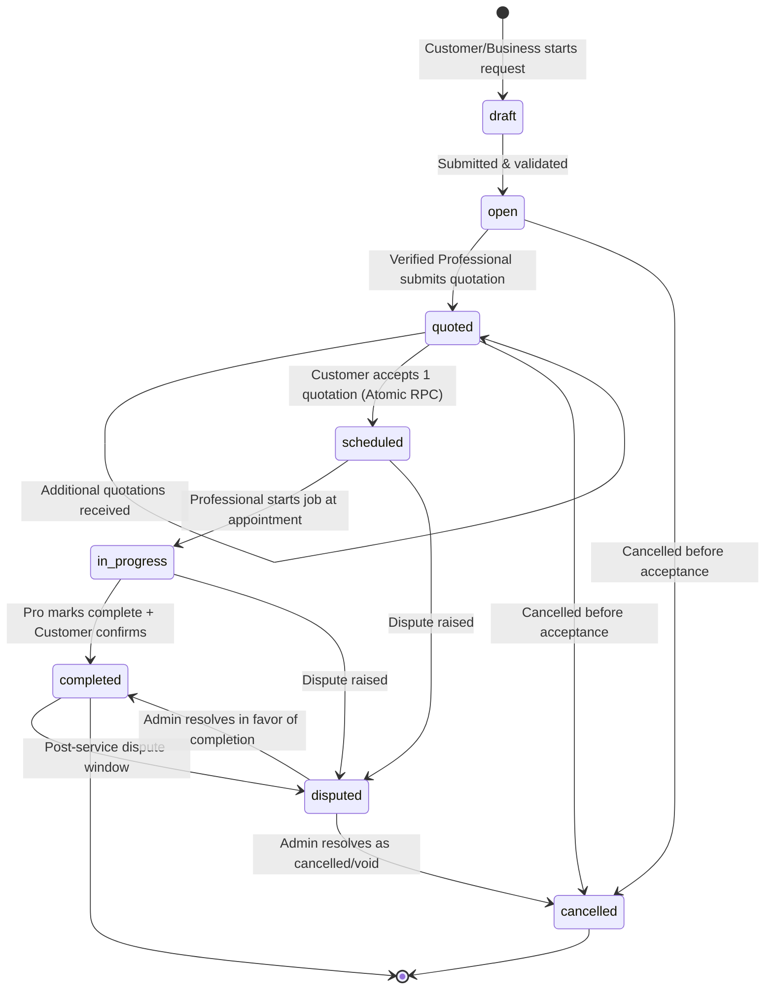
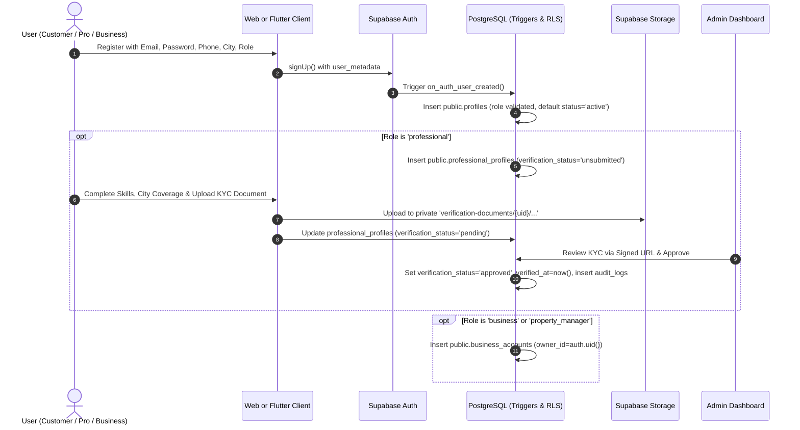
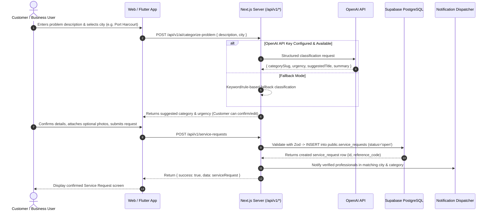
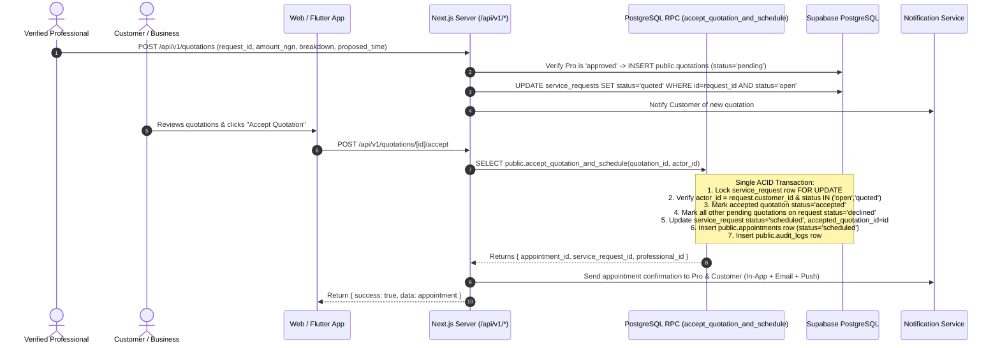
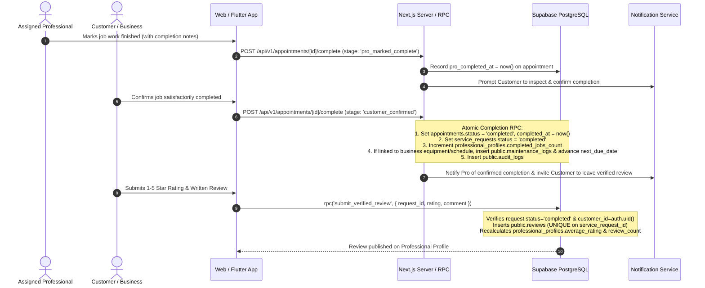
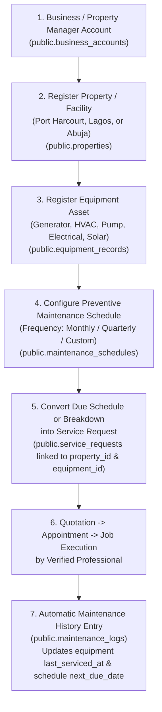
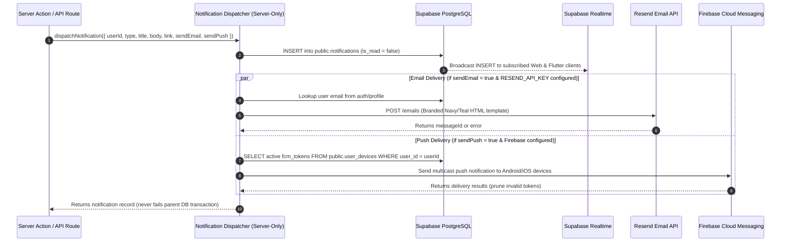

# EasyLife — System Data Flows & State Machines (`DATA_FLOW.md`)

This document defines the exact data flows and database state transitions for EasyLife's critical user journeys across Web, Android, iOS, and the Central Supabase Backend.

---

## 1. Service Request & Booking Lifecycle State Machine

---

## 2. Authentication & Role Onboarding Data Flow

---

## 3. Service Booking & AI Problem Categorization Flow

---

## 4. Quotation Acceptance & Atomic Scheduling Flow

---

## 5. Job Completion & Verified Review Flow

---

## 6. Business & Property Maintenance Flow

---

## 7. Multi-Channel Notification Delivery Flow

