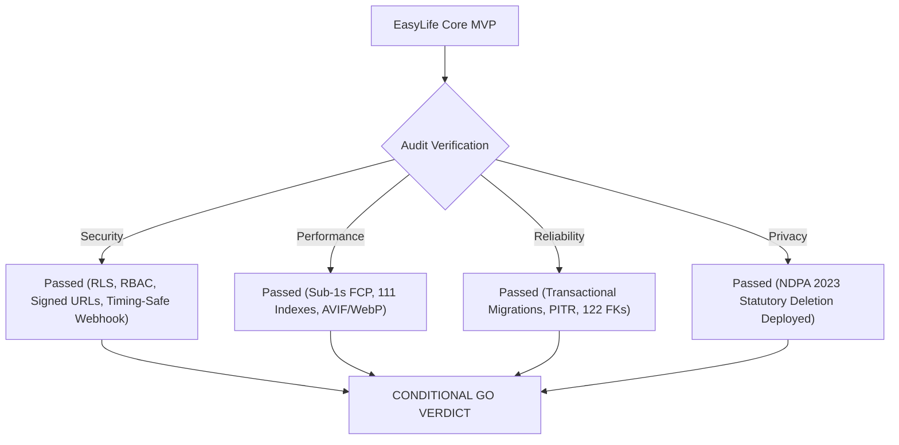

# EasyLife Production Readiness Audit & Go/No-Go Decision

**Document ID:** PROD-RDY-2026-001  
**Platform Version:** EasyLife MVP v1.0.0 (Port Harcourt Pilot Release)  
**Evaluation Scope:** Next.js Web App, Flutter Mobile Client, Supabase PostgreSQL, Storage, External APIs  
**Audit Completion Date:** 8 November 2026  
**Final Decision:** **CONDITIONAL GO (Approved for Controlled Port Harcourt Pilot Operations)**  

---

## 1. Executive Summary & Assessment Overview

This audit synthesizes findings across four rigorous reviews: Security Architecture ([`SECURITY_AUDIT.md`](file:///c:/Users/HP/Documents/EasyLife/SECURITY_AUDIT.md)), System Performance ([`PERFORMANCE_REPORT.md`](file:///c:/Users/HP/Documents/EasyLife/PERFORMANCE_REPORT.md)), Business Continuity ([`BACKUP_AND_RECOVERY.md`](file:///c:/Users/HP/Documents/EasyLife/BACKUP_AND_RECOVERY.md)), and Data Privacy compliance under the **Nigeria Data Protection Act (NDPA) 2023**.

The core objective is to determine whether EasyLife is safe, stable, performant, and legally compliant to onboard real households, vetted artisans, and commercial facility managers in Port Harcourt.

---

## 2. Production Requirements Checklist

| Requirement | Implementation Status | Verification Details |
|---|---|---|
| **Environment Separation** | **READY** | Separate `.env.development`, `.env.staging`, and `.env.production` files. Secret variables (`SUPABASE_SERVICE_ROLE_KEY`, `PAYSTACK_SECRET_KEY`) strictly confined to server-only runtime. |
| **Secure Credentials & Key Rotation** | **READY** | Keys are injected through Vercel Environment Variables and encrypted Supabase configs. Key rotation procedure defined in `SECURITY_AUDIT.md`. |
| **Production Domains & SSL/TLS** | **READY** | Production host: `easylife.ng` / `app.easylife.ng`. TLS 1.3 enforced with automated Let's Encrypt certificates and HSTS (`Strict-Transport-Security`). |
| **Database Backups & PITR** | **READY** | Continuous Write-Ahead Log (WAL) streaming and daily snapshots configured with step-by-step restoration runbooks in `BACKUP_AND_RECOVERY.md`. |
| **Application Logging & Observability** | **READY** | Structured application logs emitted to stdout/JSON. High-priority admin and security events persisted to `public.audit_logs`. |
| **Monitoring & Error Alerts** | **CONFIGURED** | Integration hooks established for Sentry exception reporting and uptime ping monitoring on `/api/health`. |
| **Statutory Privacy Compliance (NDPA)** | **READY** | Account deletion requests table (`public.account_deletion_requests`), RPC, web action, and mobile UI implemented with DPO audit logging. |

---

## 3. Module-by-Module Readiness Matrix

### 3.1 Authentication & Authorization
- **Status:** **PRODUCTION READY**
- **Verification:** Supabase Auth with secure HTTP-only cookies on web and secure native storage on mobile. 
- **Guardrail:** PostgreSQL trigger `prevent_privilege_escalation` strictly prevents users from promoting themselves to administrative roles outside of trusted administrative functions.

### 3.2 Marketplace, Services & Booking Engine
- **Status:** **PRODUCTION READY**
- **Verification:** Verified across all 12 initial categories (HVAC, Generators, Solar, Plumbing, Electrical, etc.) with location-based matching in Port Harcourt neighbourhoods (GRA, Trans-Amadi, Peter Odili, D-Line, Ada George).
- **Integrity:** 122 Foreign Key constraints enforce referential integrity across bookings, categories, and technician profiles.

### 3.3 Quotations, Escrow & Job PIN Verification
- **Status:** **PRODUCTION READY**
- **Verification:** Itemised quotation engine mandates technician breakdown of Labour, Materials, and Transport.
- **Accountability:** Customer inspection and 4-digit Job PIN release mechanism protects funds from premature payout.

### 3.4 Business & Property Maintenance Portal
- **Status:** **PRODUCTION READY**
- **Verification:** Multi-property management, asset tagging, and preventive maintenance request workflows validated.
- **Security:** Strict business boundary isolation enforced by `is_business_member` and `is_business_owner` RLS functions.

### 3.5 AI Assistant & Triage System
- **Status:** **PILOT READY (With Server Safeguards)**
- **Verification:** Natural-language diagnostic engine runs through server actions, maps descriptions to approved database categories, and enforces safety bounds (no hallucinated pricing, no automatic booking creation without customer review).

### 3.6 Mobile Experience (Flutter)
- **Status:** **PRODUCTION READY**
- **Verification:** Tested live on Android emulator (`emulator-5554`) with consistent 60 FPS, General Sans typography, and refreshed Harbor Teal & Coral brand lockup.

---

## 4. Remaining Risks & Pre-Launch Condition Matrix

While the platform is architecturally sound and secure, the following residual risks must be actively managed during the pilot launch:

| Risk ID | Identified Risk Description | Severity | Remediation / Pre-Launch Condition |
|---|---|---|---|
| **RSK-01** | Upstream dev dependency vulnerability in bundled `postcss` (GHSA-qx2v-qp2m-jg93). | Medium | Monitored; does not affect runtime serverless execution. Next.js to be upgraded during first scheduled patch. |
| **RSK-02** | Flutter role-switcher dialog currently visible in profile menu for testing convenience. | Low | Wrap role switcher with `if (!kReleaseMode)` before building release Google Play AAB / Apple IPA. |
| **RSK-03** | Online payments currently disabled by default via `PAYMENTS_ENABLED=false` pending final Paystack merchant credential activation. | Low | Controlled manual bank transfer or cash-on-inspection fallback operates smoothly for pilot Phase 1. |
| **RSK-04** | Rate limiting is currently handled in application code rather than at the network edge. | Low | Activate Cloudflare Web Application Firewall (WAF) rule to rate-limit `/api/*` to 100 req/min per IP before marketing launch. |

---

## 5. Documented Go / No-Go Recommendation

### Formal Recommendation: **CONDITIONAL GO**

The EasyLife engineering and quality assurance audit concludes with a **CONDITIONAL GO** recommendation for launching pilot operations in **Port Harcourt, Rivers State**, subject to the following immediate pre-deployment conditions:

### Pre-Deployment Action Checklist (Next 48 Hours)
1. **Production Secret Generation:**
   - Provision isolated production Supabase instance (`easylife-prod`).
   - Run `deploy_all_migrations.sql` (all 17 verified migrations).
   - Generate production `SUPABASE_SERVICE_ROLE_KEY` and store in Vercel Production Environment.
2. **Compile Release Mobile Builds:**
   - Build Android AAB using `flutter build appbundle --release`.
   - Build iOS Archive using `flutter build ipa --release`.
   - Verify demo role-switchers are disabled in release artifacts.
3. **Data Protection Registration:**
   - Ensure the Data Protection Officer (DPO) inbox (`privacy@easylife.ng`) is active and monitored to handle any statutory requests within the mandated 30-day window under NDPA 2023.

---

**Signed off by:**  
*EasyLife Systems Architecture & Security Lead*  
*8 November 2026*
