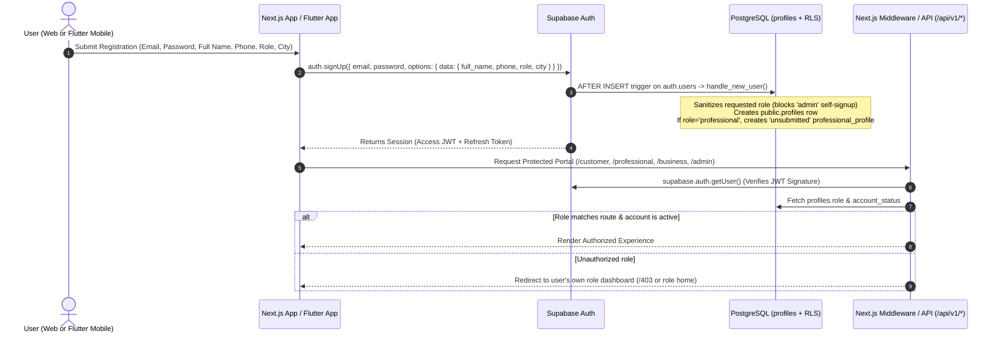

# EasyLife — Security Architecture (`SECURITY_ARCHITECTURE.md`)

## 1. Security Principles (Zero Trust & Defense-in-Depth)

EasyLife enforces security across **four distinct layers**:
1. **Edge & Route Guard Layer:** Next.js Middleware and Flutter Navigation Guards redirect unauthenticated or unauthorized users before rendering protected screens.
2. **API & Server Action Validation Layer:** Every server mutation re-verifies the Supabase JWT via `supabase.auth.getUser()`, checks user role and account status, and validates inputs with Zod schemas.
3. **Database Row Level Security (RLS) Layer:** PostgreSQL RLS policies are enabled on **every table** in `public` and `storage.objects`. Even if a client calls Supabase PostgREST directly, PostgreSQL rejects unauthorized reads or writes.
4. **Database Trigger & Constraint Layer:** Sensitive columns (`profiles.role`, `professional_profiles.verification_status`, `professional_profiles.average_rating`) are protected by PostgreSQL triggers/RPCs so non-admin users cannot tamper with them even on their own row.

---

## 2. Authentication Flow Diagram

### Session Management by Platform
- **Next.js Web (`@supabase/ssr`):** Uses HTTP-only, `SameSite=Lax`, `Secure` cookies refreshed transparently in Next.js Middleware.
- **Flutter Mobile (`supabase_flutter`):** Persists the refresh token inside platform-encrypted storage (Android Keystore / iOS Keychain) and automatically refreshes short-lived access JWTs (`3600s` expiry).

---

## 3. Role-Based Access Control (RBAC) Matrix

EasyLife supports five explicit roles stored in `public.profiles.role`:
- `customer` — Household customers booking everyday services.
- `professional` — Technicians, artisans, and service providers.
- `business` — Small and medium-sized enterprise accounts managing commercial properties and equipment.
- `property_manager` — Landlords and facility managers managing residential/commercial units and preventive maintenance.
- `admin` — Platform administrators (provisioned strictly via backend administrative seed/migration, **never** via public registration).

| Resource / Action | `customer` | `professional` | `business` / `property_manager` | `admin` |
| :--- | :--- | :--- | :--- | :--- |
| **Browse Service Categories & Verified Pros** | Read | Read | Read | Full CRUD |
| **Use AI Problem Categorization** | Execute | No | Execute | Execute |
| **Submit Verification / KYC Documents** | No | Create/Read Own | No | Read All / Approve / Reject |
| **Approve Professional Verification** | No | No | No | **Admin Only** |
| **Create Service Request** | Create/Read Own | Read Open in City & Category (if Verified) | Create/Read Own | Read/Manage All |
| **Submit Quotation** | Read on Own Request | Create (Verified Only) / Read Own | Read on Own Request | Read All |
| **Accept / Decline Quotation** | Update on Own Request | Read Status | Update on Own Request | Read All |
| **Manage Appointments & Mark Job Complete** | Read / Confirm Own | Read / Mark Complete on Assigned | Read / Confirm Own | Read/Manage All |
| **Submit Verified Review** | Create Once per Completed Job | Read / Reply to Own | Create Once per Completed Job | Moderate / Audit |
| **Raise / Participate in Dispute** | Create/Read Own | Create/Read Own | Create/Read Own | Arbitrate & Resolve All |
| **Manage Properties, Equipment & Schedules** | No | Read Assigned Job Equipment Context | Full CRUD on Own Business | Read All |
| **View Platform Audit Logs** | No | No | No | **Admin Only** |

---

## 4. PostgreSQL Row Level Security (RLS) Design

### 4.1 Security Helper Functions (`SECURITY DEFINER`)
To prevent infinite recursion in RLS policies and keep policy definitions clean and fast, PostgreSQL helper functions are defined with `SET search_path = public`:
- `public.current_user_role() RETURNS user_role` — Returns the authenticated user's role from `public.profiles`.
- `public.is_admin() RETURNS boolean` — Returns `true` only when `auth.uid()` belongs to an active `admin` profile.
- `public.is_verified_professional() RETURNS boolean` — Returns `true` only when the current user has a `professional_profiles` row with `verification_status = 'approved'`.

### 4.2 Anti-Tampering Triggers (Preventing Privilege Escalation)
Because users can update their own profile details (`full_name`, `phone`, `city`, `avatar_url`), a `BEFORE UPDATE` trigger on `public.profiles` and `public.professional_profiles` enforces:
- Non-admin users **cannot** modify `profiles.role` or `profiles.is_suspended`.
- Professionals **cannot** modify `professional_profiles.verification_status`, `verified_at`, `verified_by`, `average_rating`, or `completed_jobs_count`.
- Reviews can **only** be inserted when a matching `service_requests` record has `status = 'completed'` and `customer_id = auth.uid()`.

---

## 5. Storage Security Boundaries

1. **Private Buckets by Default for Sensitive Data:**
   - `verification-documents`, `service-request-media`, and `maintenance-and-disputes` are private buckets (`public = false`).
   - Direct public URLs do not work on private buckets; files are accessed strictly via time-limited signed URLs (`createSignedUrl`) after RLS verifies the requester's relationship to the record.
2. **Path Ownership Enforcement:**
   - Upload RLS policies enforce `(storage.foldername(name))[1] = auth.uid()::text` so a user can never overwrite or upload into another user's storage folder.
3. **File Validation:**
   - Both client-side and bucket-level constraints enforce allowed MIME types (`image/jpeg`, `image/png`, `image/webp`, `application/pdf`) and maximum file size (`2 MB`–`10 MB`).

---

## 6. Secret Key & Environment Security

| Secret Key | Where Stored | Client Exposure Allowed? | Protection Rule |
| :--- | :--- | :--- | :--- |
| `NEXT_PUBLIC_SUPABASE_ANON_KEY` | Web & Mobile Client | Yes (Public Anon Key) | Safe only because 100% of tables enforce RLS. |
| `SUPABASE_SERVICE_ROLE_KEY` | Next.js Server Only | **NEVER** | Bypasses RLS; imported only inside `src/lib/supabase/admin.ts` with `import "server-only"`. |
| `OPENAI_API_KEY` | Next.js Server Only | **NEVER** | Used only in `/api/v1/ai/categorize-problem`. |
| `RESEND_API_KEY` | Next.js Server Only | **NEVER** | Used only in server notification dispatcher. |
| `FIREBASE_PRIVATE_KEY` | Next.js Server Only | **NEVER** | Used only by server push notification service. |
| `PAYSTACK_SECRET_KEY` | Next.js Server Only | **NEVER** | Used only for server payment initialization and HMAC webhook verification. |
