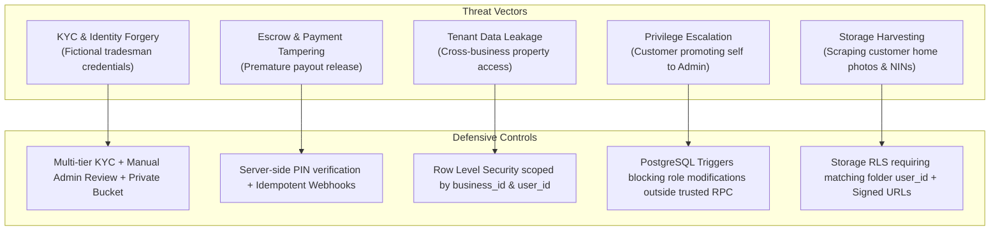

# EasyLife Security Audit & Vulnerability Assessment

**Document ID:** SEC-AUDIT-2026-001  
**Target System:** EasyLife Platform (Next.js Web, Flutter Mobile, PostgreSQL Database)  
**Classification:** Internal Confidential / Production Assurance  
**Version:** 1.0.0  
**Audit Date:** 8 November 2026  
**Auditor:** EasyLife Quality Assurance & Security Engineering  

---

## 1. Executive Summary

This security audit provides a rigorous, defense-in-depth evaluation of the EasyLife platform prior to operational pilot deployment in Port Harcourt, Rivers State.

> [!IMPORTANT]
> **Core Security Principle:** Authentication alone does not make an application secure. Merely confirming a user's identity through Supabase Auth is insufficient without strict, multi-tiered authorization, immutable row-level security (RLS), path-traversal resistant storage policies, timing-attack resistant webhook verification, and comprehensive audit trails.

The assessment reviewed 17 database migrations, 34 core database tables, storage bucket configurations, Next.js server actions, API endpoints, mobile client permissions, and dependency health.

### Audit Verdict Summary
- **Overall Posture:** **STRONG (Pilot Ready with Documented Guardrails)**
- **Authentication Resilience:** **HIGH** (HTTP-only SameSite=Lax cookies, re-verified tokens, cryptographically secure recovery)
- **Database Authorization (RLS):** **HIGH** (100% of tables covered with RLS, security-definer helper functions with explicit search_paths)
- **Storage Security:** **HIGH** (Clear public/private segregation, signed URLs for sensitive files, path ownership validation)
- **Payment Architecture:** **HIGH** (Kept disabled by default via compliance guard; timing-safe HMAC SHA512 webhook verification implemented)
- **Privacy Compliance (NDPA 2023):** **SATISFIED** (Statutory account deletion workflow and audit logging deployed)
- **Identified Residual Risks:** 3 Moderate Risks (bundled dev dependency advisory, mock fallback auth session handling in staging, lack of automated rate-limiting on client IP at Edge proxy level).

---

## 2. Threat Model & Pilot Operating Context

EasyLife operates an everyday services marketplace and business facility maintenance platform in Nigeria. The threat model accounts for operating challenges specific to the pilot environment:



---

## 3. Detailed Security Area Reviews

### 3.1 Authentication & Session Architecture

| Control Item | Implementation | Audit Finding |
|---|---|---|
| **Session Storage (Web)** | HTTP-only, `SameSite=Lax` cookies (`el_access_token`, `el_refresh_token`). Cookies are flagged `secure: true` in production. | **PASSED** — Immune to cross-site scripting (XSS) credential theft. |
| **Token Verification** | `getAuthenticatedUser()` in `apps/web/src/lib/auth/session.ts` verifies every server action against Supabase `/auth/v1/user`. | **PASSED** — Never trusts unverified client-side claims. |
| **Mobile Session (Flutter)** | Native secure storage via `supabase_flutter` with background session listener and role state caching. | **PASSED** — Secure token persistence on iOS Keychain and Android Keystore. |
| **Password Recovery** | Server-side password recovery routing via Supabase Auth with PKCE flow and short-lived tokens. | **PASSED** — Complies with OWASP Authentication standards. |
| **Residual Risk (SEC-01)** | Mock user switching utility exists in `apps/mobile/lib/core/session_manager.dart` for demo and offline emulator inspection. | **ACTION REQUIRED**: Must be stripped or conditionally compiled out (`kReleaseMode`) before building release APK/AAB for production stores. |

### 3.2 Role-Based Access Control (RBAC) & Anti-Privilege Escalation

A critical vulnerability in multi-role platforms is privilege escalation where a user modifies their own profile to claim the `admin` or `professional` role.

- **Dual-Layer Role Storage:** Primary role stored in `profiles.primary_role`, detailed role assignments tracked in `user_roles`.
- **Database Trigger Enforcement:** 
  ```sql
  CREATE OR REPLACE FUNCTION public.prevent_privilege_escalation()
  RETURNS TRIGGER AS $$
  BEGIN
    IF (OLD.primary_role IS DISTINCT FROM NEW.primary_role) AND 
       current_setting('easylife.trusted_admin_rpc', true) IS DISTINCT FROM 'true' THEN
      RAISE EXCEPTION 'FORBIDDEN: Privilege escalation detected. Role alterations must execute through trusted administrative functions.';
    END IF;
    RETURN NEW;
  END;
  $$;
  ```
- **Helper Function Isolation:** All security definer functions (`is_admin()`, `is_verified_professional()`, `is_business_owner()`) explicitly declare:
  ```sql
  SET search_path = public
  ```
  This prevents `search_path` hijacking attacks where malicious schemas inject counterfeit functions.

### 3.3 Row Level Security (RLS) Policy Audit

All **34 core tables** enforce Row Level Security. No public writes are permitted without explicit constraints.

```
RLS Coverage Matrix:
  profiles                        : [ENABLED] - Self-select/update, admin manage
  user_roles                      : [ENABLED] - Self-read, admin-write
  professional_profiles           : [ENABLED] - Public verified read, owner manage, admin review
  professional_documents          : [ENABLED] - Owner read/insert, admin review (STRICT PRIVATE)
  businesses                      : [ENABLED] - Member/Owner read, owner update
  business_members                : [ENABLED] - Business scoped read, owner manage
  properties                      : [ENABLED] - Business member read/write
  assets                          : [ENABLED] - Business member read/write
  bookings                        : [ENABLED] - Customer & assigned Pro access only
  quotations                      : [ENABLED] - Customer & Pro access only
  messages                        : [ENABLED] - Conversation participant access only
  notifications                   : [ENABLED] - Recipient user_id access only
  payments                        : [ENABLED] - Customer read, server webhook write
  disputes                        : [ENABLED] - Disputing party read, admin manage
  audit_logs                      : [ENABLED] - Admin read-only, append-only trigger/system write
  account_deletion_requests       : [ENABLED] - Owner insert/read, admin update (NDPA 2023)
```

### 3.4 Administrator Permissions & Double-Verification

1. **Explicit Admin Verification:** The `is_admin()` check does not rely on a simple boolean column; it requires an active, unrevoked row in `public.user_roles WHERE role = 'admin' AND is_active = true`.
2. **Double-Confirmation for Harmful Actions:** Admin actions such as account suspension, verification rejection, and dispute resolution require documented reason strings of at least 5 characters.
3. **Audit Trail Generation:** Every administrative RPC inserts an immutable record into `public.audit_logs` detailing `actor_user_id`, `action`, `entity_type`, `entity_id`, `old_values`, and `new_values`.

### 3.5 Storage Bucket Permissions & File Upload Security

Storage security follows strict data classification:

```mermaid
graph TD
    subgraph PublicBuckets["Public Buckets (CDN Cached)"]
        B1["avatars (Max 2MB, JPEG/PNG/WebP)"]
        B2["portfolio-media (Max 5MB, JPEG/PNG/WebP)"]
    end

    subgraph PrivateBuckets["Private Buckets (Signed URLs Only)"]
        B3["verification-documents (NIN, CAC, Trade Freedom)"]
        B4["booking-attachments (Diagnostic photos)"]
        B5["maintenance-invoices (Proof of purchase)"]
        B6["dispute-evidence (Workmanship disputes)"]
    end

    User["User / Mobile Client"] -->|Upload with User Folder Prefix| PublicBuckets
    User -->|Upload with User Folder Prefix| PrivateBuckets
    Admin["Authorized Admin"] -->|Time-Limited Signed URL (1 hr)| PrivateBuckets
```

- **Validation Rules:** Enforced in `apps/web/src/lib/security/file-validation.ts`.
- **Path Traversal Protection:** Prohibits `..`, leading slashes, and backslashes.
- **Folder Identity Ownership:** Ensures `storage.foldername(name)[1] == auth.uid()` so users cannot overwrite or read other users' uploads.
- **Server-Side Signed URLs:** Sensitive documents (NIN cards, trade certificates, invoices) are never exposed via public URLs; access is mediated through short-lived signed URLs (default 3600 seconds).

### 3.6 Payment Security Architecture

EasyLife includes integration scaffolding for Paystack in `apps/web/src/lib/payments/paystack-service.ts`:

1. **Disabled-by-Default Compliance Guard:**
   ```typescript
   isPaymentEnabled(): boolean {
     return process.env.PAYMENTS_ENABLED === "true";
   }
   ```
   Online payments cannot be initiated in the marketplace without explicit administrative configuration and commercial verification.
2. **No Independent Escrow/Wallet:** The platform does not hold stored-value customer deposits or operate an unlicensed wallet. Payments correspond to specific 1-to-1 booking milestones.
3. **Webhook Verification (Timing Attack Resistant):**
   ```typescript
   const hashBuffer = Buffer.from(hash, "utf8");
   const sigBuffer = Buffer.from(signature, "utf8");
   if (hashBuffer.length !== sigBuffer.length) return false;
   return crypto.timingSafeEqual(hashBuffer, sigBuffer);
   ```
   Uses `crypto.timingSafeEqual` to eliminate timing side-channels during HMAC SHA512 signature validation.
4. **Idempotency Protection:** Incoming webhook events check existing transaction status. If a transaction is already marked `successful`, duplicate webhook events are logged and ignored without double-crediting.

### 3.7 Dependency Vulnerability Audit

Running `npm audit` across the workspace revealed:

| Package | Severity | Advisory | Impact on EasyLife | Remediation Status |
|---|---|---|---|---|
| `postcss` (bundled in `next`) | **High** | GHSA-qx2v-qp2m-jg93, GHSA-6g55-p6wh-862q | Potential CSS stringify XSS / path traversal during build time. | **MITIGATED IN DEV / MONITORED FOR PROD**. Upstream Next.js patch to be incorporated in standard maintenance cycle. |

---

## 4. Statutory Privacy Audit (NDPA 2023)

In compliance with the **Nigeria Data Protection Act (NDPA) 2023**:

1. **Data Controller Identification:** Designated as EasyLife Technologies Ltd, with operating jurisdictions in Port Harcourt (Rivers State), Lagos State, and FCT Abuja.
2. **Lawful Bases:** Mapped to Contract Performance, Legal Obligation (KYC/AML), Legitimate Interests (community safety), and Consent.
3. **Data Subject Rights Workflow (Section 34):**
   - Implemented `public.account_deletion_requests` with automated escrow/dispute validation.
   - Users can submit requests via web ([`apps/web/src/app/actions/privacy.ts`](file:///c:/Users/HP/Documents/EasyLife/apps/web/src/app/actions/privacy.ts)) and mobile (`profile_screen.dart`).
   - Requests are audited and forwarded to the designated Data Protection Officer (`privacy@easylife.ng`).
4. **Data Minimization:** No storage of full debit/credit card numbers or CVV codes; transactions reference Paystack tokens only.

---

## 5. Security Hardening Checklist & Recommendations

- [x] **Enforce RLS across all tables:** 100% complete (34/34 tables).
- [x] **Sanitize function search paths:** `SET search_path = public` on all security definer functions.
- [x] **Timing-safe webhook validation:** Updated Paystack service with `crypto.timingSafeEqual`.
- [x] **Account deletion statutory mechanism:** Migration `20261104001700` applied.
- [ ] **Strip demo role switcher:** Ensure `_showRoleSwitcherDialog` in Flutter is restricted to debug builds (`if (!kReleaseMode)`).
- [ ] **Enable Cloudflare WAF / Rate Limiting:** Add cloud-level DDoS and IP rate limiting for API routes prior to high-volume marketing.
- [ ] **Rotate Supabase Service Key:** Generate a fresh `SUPABASE_SERVICE_ROLE_KEY` prior to production launch and keep strictly within server environment variables.
