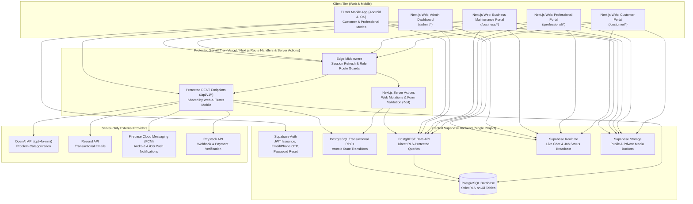
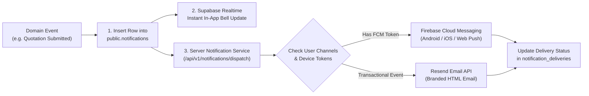
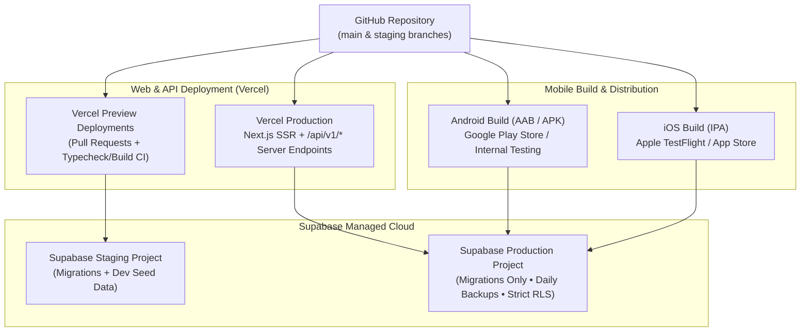

# EasyLife — System Architecture (`SYSTEM_ARCHITECTURE.md`)

## 1. Executive Summary & Architectural Philosophy

EasyLife is engineered as a **Modular Monolith + Managed BaaS (Backend-as-a-Service)** architecture. Rather than introducing fragile, expensive microservices, EasyLife uses **one central Supabase backend** (PostgreSQL 15+, Supabase Auth, Supabase Storage, Supabase Realtime) alongside **Next.js (App Router) Server Endpoints** hosted on Vercel and a **Flutter Mobile Application** for Android and iOS.

This design achieves:
- **Single Source of Truth:** Web, Android, iOS, and Admin portals read and write to one PostgreSQL database.
- **Low Operating Cost:** Zero idle container/cluster overhead; scales automatically with Nigerian market adoption across Port Harcourt, Lagos, and Abuja.
- **Defense-in-Depth Security:** Every table is protected by PostgreSQL Row Level Security (RLS), while multi-table state transitions and third-party API calls run inside transactional PostgreSQL `SECURITY DEFINER` RPCs or authenticated Next.js `/api/v1/*` endpoints.

---

## 2. Overall System Architecture Diagram



---

## 3. Component Responsibilities & Boundaries

| Component | Technology | Primary Responsibility | Security Boundary |
| :--- | :--- | :--- | :--- |
| **Web Client & SSR** | Next.js 15 (App Router), TypeScript, Tailwind CSS | Responsive UI for Customer, Professional, Business Maintenance, and Admin portals. | Uses `NEXT_PUBLIC_SUPABASE_ANON_KEY` + HTTP-only auth cookies. |
| **Mobile Client** | Flutter (Dart 3), `supabase_flutter` | Native Android and iOS experience for Customers and Service Professionals. | Uses `SUPABASE_ANON_KEY` + user JWT stored in OS secure storage (`FlutterSecureStorage`). |
| **Protected API Layer** | Next.js `/api/v1/*` Route Handlers | Unified privileged endpoints for both Web and Flutter (AI categorization, notification dispatch, admin actions, webhooks). | Verifies Supabase Bearer JWT (`supabase.auth.getUser(token)`) + role check before execution. |
| **Database & RPC Layer** | Supabase PostgreSQL 15+ | Relational storage, referential integrity, atomic workflows (`accept_quotation`, `complete_job`), and audit logs. | Row Level Security (RLS) enforced on 100% of tables in `public` schema. |
| **File Storage** | Supabase Storage | Stores profile avatars, professional KYC/verification documents, service request photos, equipment manuals, and dispute evidence. | Bucket-level RLS policies bound to `storage.objects` and folder path conventions (`{user_id}/*`). |
| **Realtime Layer** | Supabase Realtime (Postgres Changes + Presence) | Delivers instant chat messages and live status updates on service requests, quotations, and appointments. | Channel authorization gated by RLS on `messages`, `service_requests`, and `notifications`. |

---

## 4. Frontend / Backend Communication Strategy

EasyLife uses a **two-path communication model** so that both the Next.js website and the Flutter mobile app operate seamlessly against the same backend without duplicating business logic:

1. **Path A — Direct Supabase Client + PostgreSQL RLS / RPC (Standard Data & Atomic DB Transitions)**
   - **Used for:** Reading catalog/profiles, reading user-scoped records, inserting standard user-owned records (e.g., sending a chat message), and invoking database-atomic PostgreSQL RPC functions (e.g., accepting a quotation and creating an appointment in a single transaction).
   - **Why:** Both `@supabase/ssr` (Web) and `supabase_flutter` (Mobile) authenticate directly with the user's JWT and benefit from PostgreSQL RLS and sub-50ms query execution.
2. **Path B — Protected Server Endpoints (`/api/v1/*` on Next.js Server)**
   - **Used for:** Any operation requiring third-party secret keys (`OPENAI_API_KEY`, `RESEND_API_KEY`, `FIREBASE_PRIVATE_KEY`, `PAYSTACK_SECRET_KEY`) or elevated cross-user orchestration (dispatching push/email notifications, AI problem classification, Paystack webhooks, admin verification approval with email triggers).
   - **Why:** Secret keys remain exclusively on the Next.js server environment and are never embedded in browser bundles or mobile APKs/IPAs.

---

## 5. File Storage Architecture (Supabase Storage)

All files are stored in **Supabase Storage** across five purpose-specific buckets with strict MIME-type and file-size limits:

| Bucket ID | Visibility | Max Size | Allowed MIME Types | Path Convention | Access Policy |
| :--- | :--- | :--- | :--- | :--- | :--- |
| `avatars` | **Public** | `2 MB` | `image/jpeg`, `image/png`, `image/webp` | `{user_id}/avatar.{ext}` | Anyone can read; only owner (`auth.uid() = user_id`) can upload/update/delete. |
| `portfolio-media` | **Public** | `5 MB` | `image/jpeg`, `image/png`, `image/webp` | `{pro_user_id}/{item_id}.{ext}` | Anyone can read; only owning professional can write. |
| `verification-documents` | **Private** | `10 MB` | `image/jpeg`, `image/png`, `application/pdf` | `{pro_user_id}/{doc_type}_{timestamp}.{ext}` | **Strictly Private.** Only the uploading professional and `admin` role can generate short-lived signed URLs (`createSignedUrl`, 15-minute TTL). |
| `service-request-media` | **Private** | `8 MB` | `image/jpeg`, `image/png`, `image/webp` | `{request_id}/{uploader_id}/{filename}` | Accessible via signed URLs to the request owner, quoted/assigned professionals, and `admin`. |
| `maintenance-and-disputes` | **Private** | `10 MB` | `image/jpeg`, `image/png`, `image/webp`, `application/pdf` | `{entity_type}/{entity_id}/{filename}` | Accessible only to the owning business/property manager, assigned technician, or dispute participants + `admin`. |

---

## 6. Messaging and Notification Architecture

### 6.1 In-App Messaging
- Every service request or booking between a customer/business and a professional can open a `conversation` record scoped to `(service_request_id, customer_id, professional_id)`.
- Messages are persisted in `public.messages` first (source of truth).
- Connected Web and Flutter clients subscribe to `postgres_changes` (`INSERT` on `public.messages` filtered by `conversation_id`).
- No message is ever shown as "Sent" in the UI until the `INSERT` into `public.messages` succeeds.

### 6.2 Multi-Channel Notification Delivery
Every platform event (new quotation, quotation accepted, appointment reminder, job completed, verification decision, dispute update) writes a durable record to `public.notifications` first, and then dispatches external channels asynchronously on the server:



---

## 7. Error Handling Architecture

1. **Standardized Response Envelope:** Every server action and `/api/v1/*` route returns a strongly typed discriminated union (`ApiResult<T>`):
   ```ts
   type ApiResult<T> =
     | { success: true; data: T; meta?: { requestId: string; timestamp: string } }
     | {
         success: false;
         error: {
           code: ApiErrorCode;
           message: string; // Safe, human-readable message for UI display
           fieldErrors?: Record<string, string[]>;
           requestId: string;
         };
       };
   ```
2. **No Raw Database Errors Exposed:** PostgreSQL error codes (e.g., `23505` unique violation, `42501` RLS violation) are mapped on the server to safe domain error codes (`CONFLICT`, `FORBIDDEN`, `VALIDATION_ERROR`, `NOT_FOUND`, `RATE_LIMITED`, `EXTERNAL_SERVICE_ERROR`).
3. **Zero Fabricated Success Rule (Rules 12 & 13):** Client forms remain in `submitting` state until `result.success === true` is returned from the backend. If the network drops or RLS blocks a write, an explicit error banner with retry guidance is rendered.
4. **Graceful External Service Degradation:**
   - If `OPENAI_API_KEY` is missing or OpenAI times out during problem categorization, the endpoint returns a structured fallback allowing manual category selection so the customer is never blocked from posting a service request.
   - If Resend or FCM fails after a booking is saved, the database booking succeeds, the in-app notification is saved, and the failed external delivery is logged for retry.

---

## 8. Logging, Auditing & Monitoring

1. **Immutable Audit Logs (`public.audit_logs`):**
   - Sensitive operations—professional verification approvals/rejections, role changes, quotation acceptance, job completion sign-offs, and dispute resolutions—write an immutable record (`actor_id`, `action`, `entity_type`, `entity_id`, `metadata`, `created_at`) inside the database transaction.
2. **Structured Server Logging:**
   - Server endpoints emit structured JSON logs (`level`, `requestId`, `route`, `userId`, `role`, `durationMs`, `errorCode`) compatible with Vercel Runtime Logs.
   - **PII & Secret Redaction:** Passwords, tokens, Authorization headers, and API keys are never logged.
3. **Health & Readiness Monitoring:**
   - `/api/v1/health` reports application uptime and verifies connectivity to Supabase without exposing internal credentials.

---

## 9. Deployment Architecture



- **Environment Separation:** Development/staging and production use isolated environment variables. Production never executes `supabase/seed/` scripts (Rule 17 & 18).
- **Database Migrations:** Applied sequentially via `supabase/migrations/*.sql` under version control before deploying application updates.
